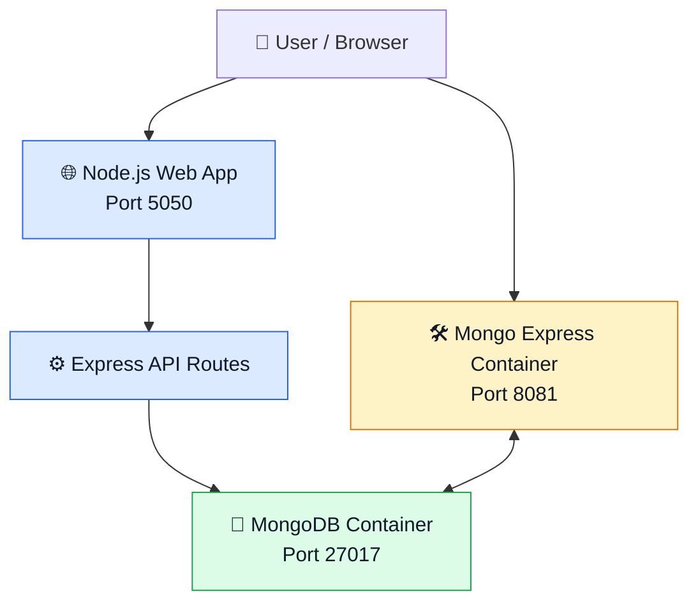

# 🚀 Node.js Web App + MongoDB + Mongo Express | Docker Project

<p align="center">
  
  
  
  
</p>

<p align="center">
  <b>Containerize. Connect. Manage.</b><br/>
  A hands-on project demonstrating how a Node.js web application integrates with MongoDB and Mongo Express using Docker.
</p>

---

## 📌 About the Project

Ever wondered how a web application communicates with a database while keeping its services separate?

This project demonstrates how to run a **Node.js web application alongside MongoDB and Mongo Express**, using Docker containers to run the database services and Docker Compose to manage them together.

The Node.js application serves a website and provides API endpoints for user data. MongoDB stores the data, while Mongo Express provides a browser-based interface for database administration.

### ✨ Key Highlights

- 🐳 **Docker:** Run MongoDB and Mongo Express in isolated containers.
- 🔗 **Container Networking:** Enable Mongo Express to communicate with MongoDB.
- 🧩 **Docker Compose:** Define and manage multiple services using a single YAML file.
- 🗄️ **Database Integration:** Store and retrieve user data using MongoDB.
- 🌐 **Web Application:** Serve a website and expose API endpoints through Node.js and Express.

## 🏗️ Architecture

The project uses separate services for the web application, database, and database administration.



**How it works:**

1. The user accesses the Node.js web application through the browser.
2. The application handles requests through its Express routes.
3. MongoDB stores the application data in a database collection.
4. Mongo Express provides a web interface to inspect and manage MongoDB data.
5. Docker Compose starts and manages the MongoDB and Mongo Express services together.

> **Note:** In the current setup, the Node.js application runs on the host machine, while MongoDB and Mongo Express run in Docker containers.

## 🛠️ Technology Stack

| Technology | Purpose |
|---|---|
| Node.js | JavaScript runtime for the application |
| Express.js | Web server and API routes |
| MongoDB | NoSQL database for storing user data |
| Mongo Express | Browser-based MongoDB administration |
| Docker | Containerization of database services |
| Docker Compose | Multi-container service management |

## 📂 Project Structure

```text
node-webapp-integration-with-mongo-mongoexpress-dockercontainers/
│
├── public/                 # Static website files
├── server.js               # Node.js application and API routes
├── package.json            # Application dependencies
├── package-lock.json       # Dependency lock file
├── mongocompose.yml        # MongoDB and Mongo Express services
└── README.md               # Project documentation
```

## ⚙️ Getting Started

### Prerequisites

Make sure you have installed:

- [Docker Desktop](https://www.docker.com/products/docker-desktop/) or Docker Engine with Docker Compose
- [Node.js](https://nodejs.org/) and npm

### 1️⃣ Clone the Repository

```bash
git clone https://github.com/kunals-repo/node-webapp-integration-with-mongo-mongoexpress-dockercontainers.git

cd node-webapp-integration-with-mongo-mongoexpress-dockercontainers
```

### 2️⃣ Start MongoDB and Mongo Express

Run the following command from the project directory:

```bash
docker compose -f mongocompose.yml up -d
```

Check whether the containers are running:

```bash
docker compose -f mongocompose.yml ps
```

View the container logs:

```bash
docker compose -f mongocompose.yml logs -f
```

### 3️⃣ Start the Node.js Application

Install the dependencies:

```bash
npm install
```

Start the application:

```bash
node server.js
```

The application should now be listening on port `5050`.

### 4️⃣ Access the Services

| Service | Address |
|---|---|
| 🌐 Node.js Web App | [http://localhost:5050](http://localhost:5050) |
| 🛠️ Mongo Express | [http://localhost:8081](http://localhost:8081) |
| 🗄️ MongoDB | `localhost:27017` |

Use the Mongo Express credentials configured in `mongocompose.yml` when prompted.

## 🔌 API Endpoints

The Node.js application includes the following routes:

| HTTP Method | Endpoint | Description |
|---|---|---|
| `GET` | `/getUsers` | Retrieve user records from MongoDB |
| `POST` | `/addUser` | Add a user record to MongoDB |

These endpoints demonstrate how an application can interact with a database through API requests.

## 🐳 Useful Docker Commands

**Start services**
```bash
docker compose -f mongocompose.yml up -d
```

**List running services**
```bash
docker compose -f mongocompose.yml ps
```

**Follow service logs**
```bash
docker compose -f mongocompose.yml logs -f
```

**Stop and remove containers**
```bash
docker compose -f mongocompose.yml down
```

**Restart services**
```bash
docker compose -f mongocompose.yml restart
```

> **Data persistence:** If you configure a named Docker volume for MongoDB, the database files can persist after the container is removed. Confirm the volume configuration in your Compose file.

## 🎯 What I Learned

Through this project, I explored practical containerization and application integration concepts:

- Creating and managing Docker containers.
- Configuring port mappings for accessing containerized services.
- Connecting services through Docker Compose networking.
- Managing multiple services with a single YAML configuration.
- Integrating a Node.js application with MongoDB.
- Using Mongo Express to inspect and manage database records.
- Troubleshooting container startup and connectivity issues.

## 🔐 Security Considerations

This project is intended for learning and development.

- Replace sample database and Mongo Express credentials before using the project in a shared environment.
- Avoid committing passwords, connection strings containing secrets, or other sensitive configuration to GitHub.
- Restrict database ports and administrative interfaces when deploying outside a local development environment.

## 🚀 Future Improvements

Potential enhancements for this project include:

- [ ] Containerize the Node.js application.
- [ ] Manage all three services through a single Docker Compose configuration.
- [ ] Configure a persistent MongoDB volume.
- [ ] Move credentials into an environment file and exclude it from Git.
- [ ] Add health checks and service readiness conditions.
- [ ] Implement a CI/CD pipeline for automated testing and deployment.

## 👨‍💻 Author

**Kunal**

Cloud & DevOps Enthusiast | Azure | Docker | Terraform | CI/CD

🔗 **GitHub Repository:** [Node.js Web App Integration with MongoDB and Mongo Express](https://github.com/kunals-repo/node-webapp-integration-with-mongo-mongoexpress-dockercontainers)

---

<p align="center">
  ⭐ If you find this project useful, consider giving the repository a star!<br/>
  <b>Keep learning. Keep building. Keep automating. 🚀</b>
</p>
